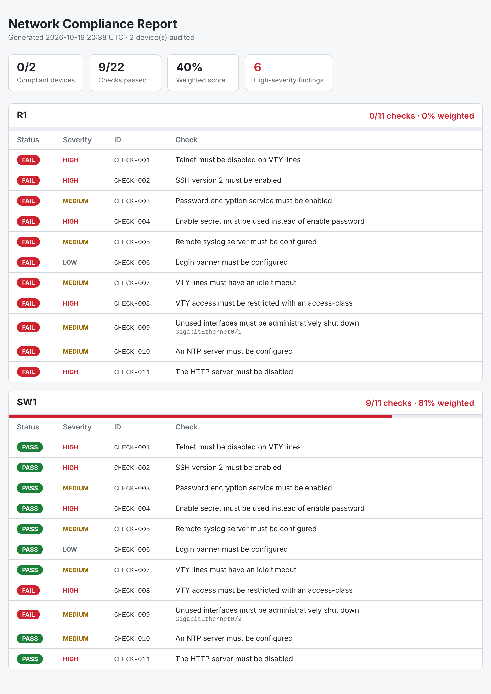

# network-compliance-ansible


Network compliance **audit and remediation** framework built with Ansible. It checks Cisco IOS configurations against security rules, scores each device, produces HTML/JSON reports and per-device remediation plans, and can apply the fixes to live devices in a closed loop.



## Features

**Audit**
- **Data-driven rules**: checks live in YAML (`rules/cisco_ios.yml`), not in tasks. A new rule is a few lines of YAML with its severity and its fix.
- **Two rule engines**: regex rules on the raw config, and structural rules (`type: parsed`) that parse the config with `cisco.ios` resource modules (`state: parsed`) and reason on structured data.
- **Weighted scoring**: high / medium / low severities, so one critical gap costs more than several minor ones.
- **Offline or live**: audit configuration files (CI, no device needed) or read `show running-config` over SSH.

**Remediation**
- **Remediation plans**: a ready-to-review IOS command file per non-compliant device. Site-specific values come from the inventory; fixes that need a human decision (secrets) are flagged as manual.
- **Closed-loop remediation**: `playbooks/remediate.yml` backs up the config, applies the fixes one device at a time (`--check --diff` first), then re-audits to prove the findings are closed. It refuses to run offline or without explicit confirmation.

**Reporting**
- **HTML report** for humans: one page for all devices, scores, findings and affected interfaces.
- **JSON report** for machines (SIEM, GRC tooling, CI gates); the CI publishes a summary table on every run.

**Engineering**
- **Custom filter plugin** in Python for structural checks, covered by `pytest` unit tests.
- **Rule regression tests**: every rule must have passing and failing cases, and a remediation.
- **Molecule** role test against a golden config (must score 100%) and a fully non-compliant config.
- **Execution Environment** (`ansible-builder`) so the audit runs the same on a laptop, in CI or in AWX.
- **Quality gates** on every PR: `ansible-lint` (production profile), `ruff`, `pytest`, Molecule, `gitleaks`.

## How it works

```
                      ┌──────────────────────────────┐
 rules/cisco_ios.yml ─┤                              ├─► reports/compliance-report.html
                      │   role: compliance_audit     ├─► reports/compliance-report.json
 config source:       │   regex + parsed checks      ├─► reports/remediation/<device>.cfg
  file  (offline) ────┤   weighted score             │
  device (SSH) ───────┤                              ├─► playbooks/remediate.yml
                      └──────────────────────────────┘     backup → apply → re-audit
```

A rule carries its detection, severity and fix:

```yaml
- id: CHECK-001
  title: Telnet must be disabled on VTY lines
  severity: high
  pattern: 'transport input (all|.*telnet)'
  expect: absent          # present = must be found, absent = must not be found
  remediation:
    - parents: ["line vty 0 4"]
      lines: ["transport input ssh"]
```

## Current checks (Cisco IOS)

| ID | Check | Severity | Engine |
|---|---|---|---|
| CHECK-001 | Telnet must be disabled on VTY lines | high | regex |
| CHECK-002 | SSH version 2 must be enabled | high | regex |
| CHECK-003 | Password encryption service must be enabled | medium | regex |
| CHECK-004 | Enable secret must be used instead of enable password | high | regex (manual fix) |
| CHECK-005 | Remote syslog server must be configured | medium | regex |
| CHECK-006 | Login banner must be configured | low | regex |
| CHECK-007 | VTY lines must have an idle timeout | medium | regex |
| CHECK-008 | VTY access must be restricted with an access-class | high | regex |
| CHECK-009 | Unused interfaces must be administratively shut down | medium | parsed |
| CHECK-010 | An NTP server must be configured | medium | regex |
| CHECK-011 | The HTTP server must be disabled | high | regex |
| CHECK-012 | Default SNMP communities (public, private) must not be used | high | regex |
| CHECK-013 | IP source routing must be disabled | medium | regex |

## Quick start

```bash
python3 -m venv .venv && source .venv/bin/activate
pip install -r requirements.txt
ansible-galaxy collection install -r requirements.yml
ansible-playbook playbooks/audit.yml
open reports/compliance-report.html   # macOS (use xdg-open on Linux)
```

The sample configs are intentionally imperfect: `R1` fails every check and `SW1` fails two of them (VTY access-class, one unused interface), so the audit is expected to fail.

Example remediation plan (`reports/remediation/SW1.cfg`):

```
! CHECK-008 [HIGH] VTY access must be restricted with an access-class
ip access-list standard MGMT-ACCESS
 permit 192.168.100.0 0.0.0.255
line vty 0 4
 access-class MGMT-ACCESS in
!
! CHECK-009 [MEDIUM] Unused interfaces must be administratively shut down
interface GigabitEthernet0/2
 shutdown
```

Query the JSON report, e.g. list every failed high-severity check:

```bash
jq -r '.devices[] | .name as $d | .results[] | select(.status == "FAIL" and .severity == "high") | "\($d) \(.id) \(.title)"' reports/compliance-report.json
```

## Live devices

See [docs/lab.md](docs/lab.md) for the GNS3 lab (topology, device bootstrap, inventory, vault).

```bash
cp -r inventories/lab.example inventories/lab
ansible-playbook -i inventories/lab playbooks/audit.yml --ask-vault-pass

# Remediation: dry run first, then apply
ansible-playbook -i inventories/lab playbooks/remediate.yml --check --diff --ask-vault-pass
ansible-playbook -i inventories/lab playbooks/remediate.yml --diff --ask-vault-pass -e remediation_confirm=true
```

## Run in a container (Execution Environment)

```bash
pip install ansible-builder ansible-navigator
ansible-builder build -t network-compliance-ee:latest
ansible-navigator run playbooks/audit.yml --eei network-compliance-ee:latest --pp never -m stdout
```

## Testing

```bash
ansible-lint                                    # production profile
ansible-playbook tests/test_rules.yml           # rule regression cases
pytest -q tests/unit                            # filter plugin unit tests
cd roles/compliance_audit && molecule test      # end-to-end role test
```

## Role variables

| Variable | Default | Description |
|---|---|---|
| `compliance_audit_config_source` | `file` | `file` (offline) or `device` (`show running-config` over SSH) |
| `compliance_audit_checks` | `[]` | List of checks to evaluate |
| `compliance_audit_config_file` | `""` | Path to the device configuration to audit |
| `compliance_audit_fail_on_noncompliance` | `true` | Fail the host if at least one check fails |
| `compliance_audit_severity_weights` | `{high: 3, medium: 2, low: 1}` | Weight of each severity in the score |
| `compliance_audit_remediation_enabled` | `true` | Generate per-device remediation plans |
| `compliance_audit_remediation_dir` | `reports/remediation` | Remediation plans output directory |
| `compliance_audit_remediation_syslog_host` | `<syslog-server-ip>` | Syslog server used in remediation commands |
| `compliance_audit_remediation_ntp_server` | `<ntp-server-ip>` | NTP server used in remediation commands |
| `compliance_audit_remediation_banner` | `Authorized access only. ...` | Login banner text |
| `compliance_audit_remediation_vty_timeout` | `10` | VTY idle timeout (minutes) |
| `compliance_audit_remediation_mgmt_acl` | `MGMT-ACCESS` | Name of the management ACL |
| `compliance_audit_remediation_mgmt_network` | `<mgmt-network> <wildcard>` | Network allowed on VTY lines |
| `compliance_audit_report_enabled` | `true` | Generate the HTML report |
| `compliance_audit_report_path` | `reports/compliance-report.html` | HTML report output path |
| `compliance_audit_json_report_enabled` | `true` | Generate the JSON report |
| `compliance_audit_json_report_path` | `reports/compliance-report.json` | JSON report output path |

## Project structure

```
├── inventories/offline/            # Inventory for offline (file-based) audits
├── inventories/lab.example/        # Template inventory for live devices (SSH)
├── lab/bootstrap/                  # Console bootstrap configs for the GNS3 lab
├── playbooks/audit.yml             # Audit entry point
├── playbooks/remediate.yml         # Closed-loop remediation (live devices)
├── roles/compliance_audit/
│   ├── tasks/                      # Audit flow, parsing, structural checks
│   ├── filter_plugins/             # Python filters used by structural checks
│   ├── molecule/default/           # End-to-end role test (golden + non-compliant configs)
│   └── templates/                  # HTML, JSON and remediation outputs
├── rules/cisco_ios.yml             # Compliance rules
├── samples/configs/                # Sample device configurations
├── tests/                          # Rule regression cases + Python unit tests
├── docs/lab.md                     # GNS3 lab guide
├── execution-environment.yml       # Container image definition (ansible-builder)
└── .github/workflows/              # CI (lint, tests, audit, secrets) + EE build
```

## Roadmap

- [x] **Level 1**: inventory, first checks
- [x] **Level 2**: role, YAML rules, HTML report, weighted scoring, JSON export
- [x] **Level 3**: structural checks with `cisco.ios` resource modules, live config source over SSH
- [x] **Level 4**: remediation plans and closed-loop remediation playbook
- [x] **Level 5**: custom filter plugin, Molecule, Execution Environment
- [ ] **Next**: validation on the GNS3 lab, AWX job templates, more vendors (Arista EOS)

## License

MIT
